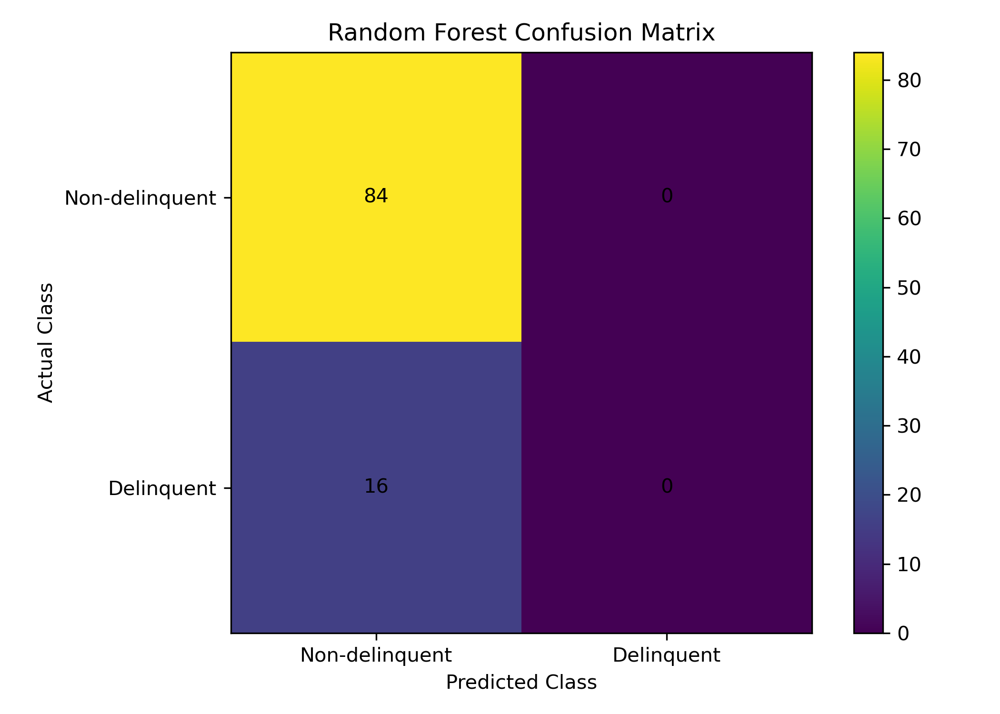
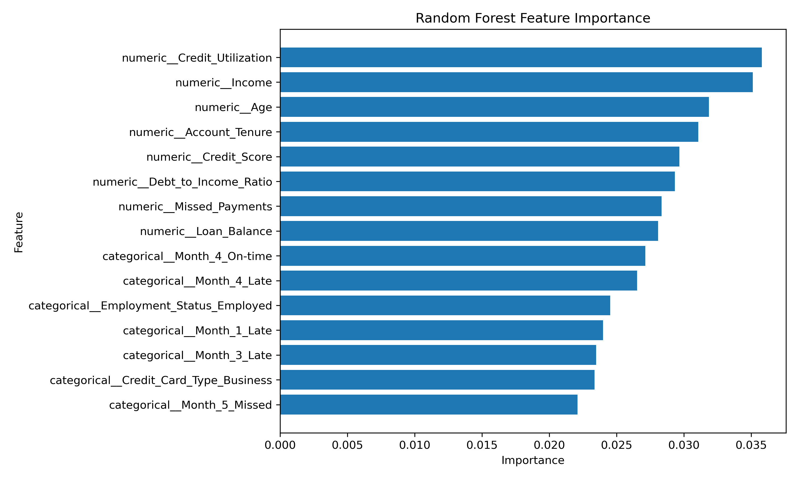

# Credit Risk Prediction

## Project Overview
This project explores credit risk assessment by analysing borrower-related data and identifying patterns associated with potential loan defaults.

## Objectives
- Understand key factors associated with credit risk.
- Analyse borrower information to identify risk patterns.
- Build a machine learning model to predict loan default risk.
- Understand how predictive insights can support lending decisions.

## Tools & Technologies
- Python
- Pandas
- Scikit-learn
- Data Analysis
- Machine Learning

## Business Relevance
Credit risk prediction can help financial institutions:
- Identify potentially high-risk borrowers.
- Support informed lending decisions.
- Improve risk assessment processes.
- Reduce potential loan default exposure.

## Project Repository
This project demonstrates the application of data analytics and machine learning to a practical financial risk management problem.

## Project Visualizations

### 1. Class Distribution

### 2. Confusion Matrix

### 3. Feature Importance

