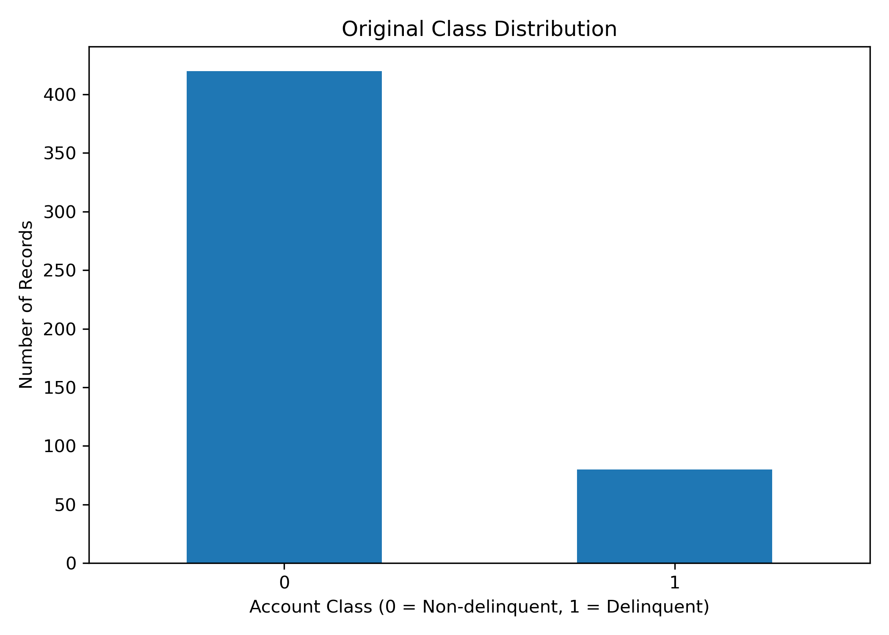
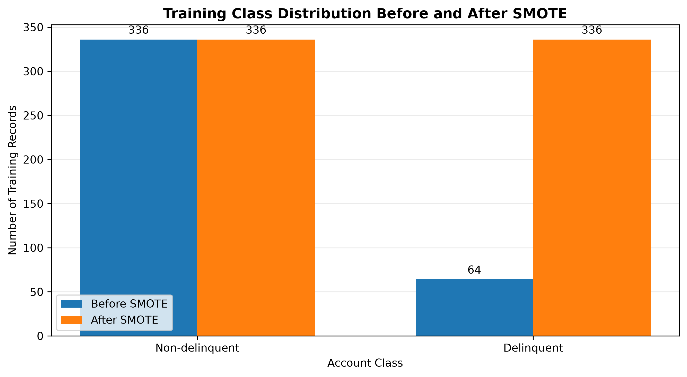
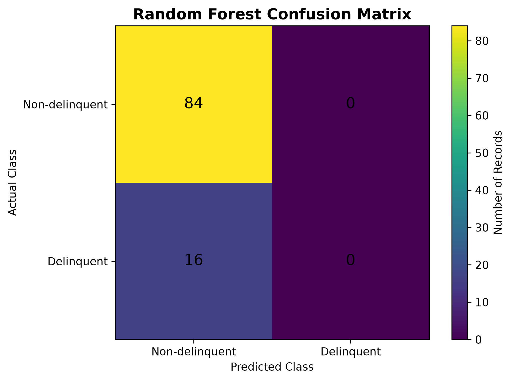
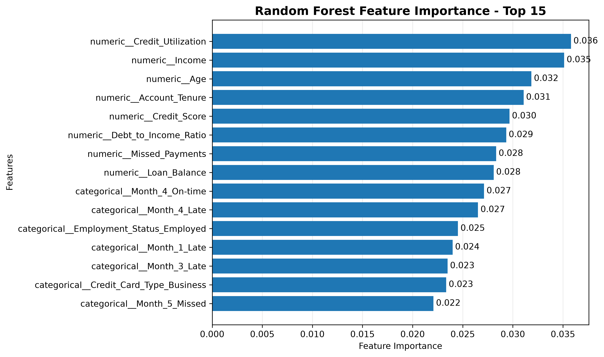

# Credit Risk Prediction

## Project Overview

This project explores credit risk assessment by analysing borrower-related data and identifying patterns associated with potential loan defaults.

It demonstrates how data analytics and machine learning can help identify delinquency patterns and provide insights to support financial risk assessment.

## Project Scope

This portfolio project combines two related activities:

- **Forage Job Simulation:** Completed the Tata iQ GenAI Powered Data Analytics Job Simulation, involving exploratory data analysis, identification of delinquency patterns, and preparation of business recommendations for a fictional financial services company.
- **Independent Python Analysis:** Conducted additional data preprocessing, class-imbalance analysis, and machine learning experiments using Logistic Regression and Random Forest to evaluate loan delinquency prediction.

The Python modelling results are independent analysis and should not be confused with the findings or deliverables of the Forage simulation.

## Objectives

- Understand key factors associated with credit risk.
- Analyse borrower information to identify risk patterns.
- Explore machine learning classification models to analyse loan delinquency patterns.
- Evaluate model performance using appropriate classification metrics.
- Understand how predictive insights can support lending and risk-management decisions.

## Tools & Technologies

- **Programming Language:** Python
- **Data Analysis:** Pandas, NumPy
- **Machine Learning:** Scikit-learn, Logistic Regression, Random Forest
- **Class Imbalance Handling:** Imbalanced-learn (SMOTE)
- **Data Visualization:** Matplotlib
- **Data Storage & Reporting:** Excel, CSV
- **Model Persistence:** Joblib
- **Development Environment:** Spyder

## Requirements

The project uses the following Python libraries:

- pandas
- numpy
- scikit-learn
- imbalanced-learn
- matplotlib
- openpyxl
- joblib
- seaborn

Install the dependencies using:

```bash
pip install -r requirements.txt
```

## Methodology

The independent Python analysis follows these steps:

1. **Data Loading:** Imported the borrower dataset from an Excel file.
2. **Data Preprocessing:** Handled missing values, scaled numerical features, and encoded categorical variables.
3. **Train-Test Split:** Divided the dataset into 80% training data and 20% testing data.
4. **Class Imbalance Handling:** Applied SMOTE within the training pipelines to address the minority delinquent class.
5. **Model Development:** Trained Logistic Regression and Random Forest classifiers.
6. **Baseline Comparison:** Evaluated both models against a majority-class baseline.
7. **Model Evaluation:** Compared accuracy, balanced accuracy, precision, recall, and F1-score.
8. **Output Generation:** Saved model results, predictions, trained pipelines, and visualizations.

## Business Relevance

This project demonstrates how data analytics can support financial risk management and lending decisions.

Key business applications include:

- **Borrower Risk Identification:** Identify patterns associated with borrowers who may have a higher likelihood of default.
- **Lending Decision Support:** Provide data-driven insights to support loan approval and credit assessment processes.
- **Risk Exposure Management:** Help financial institutions understand potential default risks and improve risk monitoring.
- **Data-Driven Decision Making:** Translate borrower data and predictive model outputs into insights for business stakeholders.
- **Model Interpretability:** Examine model feature importance to understand which borrower-related variables influenced the Random Forest model.

## Model Results

The project includes the following evaluation and analysis outputs:

- **Class Distribution:** Examined the original dataset to understand class imbalance.
- **SMOTE Analysis:** Applied Synthetic Minority Over-sampling Technique (SMOTE) to address class imbalance in the training data.
- **Confusion Matrix:** Evaluated Random Forest classification performance by examining correct and incorrect predictions.
- **Feature Importance:** Identified influential features in the Random Forest model.

### Independent Python Model Performance

The dataset contained 500 records, including 420 non-delinquent accounts and 80 delinquent accounts.

The data was divided into training (80%) and testing (20%) sets. Logistic Regression and Random Forest were evaluated against a baseline model. SMOTE was applied only within the training pipelines to avoid data leakage into the test set.

| Model | Accuracy | Balanced Accuracy | Delinquent Precision | Delinquent Recall | Delinquent F1-score |
|---|---:|---:|---:|---:|---:|
| Baseline Model | 84% | 50.00% | 0% | 0% | 0% |
| Logistic Regression | 74% | 54.17% | 22.22% | 25% | 23.53% |
| Random Forest | 84% | 50.00% | 0% | 0% | 0% |

### Key Findings

- The baseline model and Random Forest achieved 84% accuracy but failed to identify delinquent borrowers.
- Logistic Regression performed better in detecting delinquency, identifying 25% of actual delinquent accounts.
- Logistic Regression achieved the highest balanced accuracy (54.17%) among the evaluated models.
- Logistic Regression achieved a delinquent precision of 22.22% and an F1-score of 23.53%.
- Overall predictive performance remains limited, highlighting the challenges of class imbalance and the need for further model improvement.

**Important:** Accuracy alone is not sufficient to evaluate credit-risk models. Delinquent precision, recall, F1-score, and balanced accuracy provide additional insight into their ability to identify borrowers at risk.

## Limitations & Future Improvements

### Limitations

- Model performance depends on the quality and representativeness of the dataset.
- Class imbalance can affect the reliability of predictions.
- The test set contains only 16 delinquent accounts, so the evaluation results should be interpreted cautiously.
- Feature importance indicates model-level relationships but does not establish causation.
- The current models demonstrate limited ability to identify delinquent borrowers.
- Predictions should support, not replace, financial risk assessment and human decision-making.

### Future Improvements

- Evaluate additional classification algorithms.
- Explore hyperparameter tuning to improve model performance.
- Compare models using precision, recall, F1-score, ROC-AUC, and other relevant metrics.
- Explore explainable AI techniques to improve model transparency.
- Develop an interactive credit risk monitoring dashboard.

## How to Run the Project

1. Clone or download this repository.
2. Ensure Python is installed.
3. Install the required libraries:

   ```bash
   pip install -r requirements.txt
   ```

4. Ensure the dataset is available at:

   `data/Delinquency_prediction_dataset.xlsx`

5. Run the Python script from the repository's root directory:

   ```bash
   python scripts/credit_risk_model.py
   ```

The script generates model reports, predictions, trained model pipelines, and visualizations in the relevant project folders.

## Project Structure

```text
credit-risk-prediction/
│
├── data/
│   └── Delinquency_prediction_dataset.xlsx
│
├── models/
│   ├── logistic_model.pkl
│   └── random_forest_model.pkl
│
├── outputs/
│   └── reports/
│       └── delinquency_predictions_output.xlsx
│
├── scripts/
│   └── credit_risk_model.py
│
├── visuals/
│   ├── class_distribution.png
│   ├── smote_distribution.png
│   ├── confusion_matrix.png
│   └── feature_importance.png
│
├── requirements.txt
└── README.md
```

## Project Visualizations

### 1. Original Class Distribution



### 2. Class Distribution After SMOTE



### 3. Random Forest Confusion Matrix



### 4. Random Forest Feature Importance



---

**Project Focus:** Credit Risk Analysis | Business Analytics | Machine Learning | Financial Risk Management
