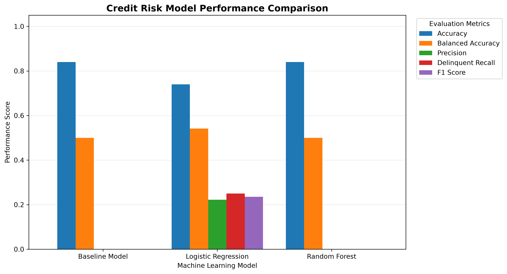

# Credit Risk Prediction

## Project Overview

This project explores credit risk assessment by analysing borrower-related data and identifying patterns associated with potential loan delinquency.

It demonstrates how data analytics and machine learning can support financial risk assessment through data preprocessing, exploratory analysis, class imbalance handling, model evaluation, and business-focused interpretation.

## Project Scope

This portfolio project combines two related activities:

- **Forage Job Simulation:** Completed the Tata iQ GenAI Powered Data Analytics Job Simulation, involving exploratory data analysis, identification of delinquency patterns, and preparation of business recommendations for a fictional financial services company.
- **Independent Python Analysis:** Conducted additional data preprocessing, class-imbalance analysis, and machine learning experiments using Logistic Regression and Random Forest.

The Python modelling results are independent analysis and should not be confused with the findings or deliverables of the Forage simulation.

## Objectives

- Understand factors associated with credit risk.
- Analyse borrower information to identify risk patterns.
- Explore machine learning classification models for loan delinquency analysis.
- Evaluate model performance using appropriate classification metrics.
- Translate predictive findings into insights for business and risk-management decisions.

## Tools & Technologies

- **Programming:** Python
- **Data Analysis:** Pandas, NumPy
- **Machine Learning:** Scikit-learn, Logistic Regression, Random Forest
- **Class Imbalance Handling:** Imbalanced-learn (SMOTE)
- **Data Visualisation:** Matplotlib, Seaborn
- **Reporting:** Excel, CSV
- **Model Persistence:** Joblib
- **Development Environment:** Spyder

## Requirements

Install the required libraries using:

```bash
pip install -r requirements.txt
```

## Methodology

The independent Python analysis follows these steps:

1. **Data Loading:** Imported the borrower dataset from Excel.
2. **Data Preprocessing:** Handled missing values, scaled numerical features, and encoded categorical variables.
3. **Train-Test Split:** Divided the dataset into 80% training and 20% testing data.
4. **Class Imbalance Handling:** Applied SMOTE within the training pipelines to address the minority delinquent class.
5. **Model Development:** Trained Logistic Regression and Random Forest classifiers.
6. **Baseline Comparison:** Evaluated the models against a majority-class baseline.
7. **Model Evaluation:** Compared accuracy, balanced accuracy, precision, recall, and F1-score.
8. **Output Generation:** Generated performance reports, predictions, trained model pipelines, and visualisations.

## Independent Python Model Performance

The dataset contained 500 records:

- Non-delinquent accounts: 420 (84%)
- Delinquent accounts: 80 (16%)

The data was divided into 80% training and 20% testing sets. SMOTE was applied only within the training pipelines to avoid data leakage into the test set.

| Model | Accuracy | Balanced Accuracy | Delinquent Precision | Delinquent Recall | Delinquent F1-score |
|---|---:|---:|---:|---:|---:|
| Baseline Model | 84% | 50.00% | 0% | 0% | 0% |
| Logistic Regression | 74% | 54.17% | 22.22% | 25% | 23.53% |
| Random Forest | 84% | 50.00% | 0% | 0% | 0% |

### Key Findings

- The baseline model and Random Forest achieved 84% accuracy but failed to identify delinquent borrowers.
- Logistic Regression performed better in detecting delinquency, identifying 25% of actual delinquent accounts.
- Logistic Regression achieved the highest balanced accuracy (54.17%).
- Its delinquent precision was 22.22%, with an F1-score of 23.53%.
- Overall predictive performance remains limited, indicating that further model development is necessary.

**Important:** Accuracy alone is insufficient for evaluating credit-risk models. Delinquent precision, recall, F1-score, and balanced accuracy provide additional insight into their ability to identify borrowers at risk.

## Business Relevance

The project demonstrates how data analytics can support financial risk assessment and lending decisions.

Potential business applications include:

- **Borrower Risk Identification:** Examine patterns associated with potential loan delinquency.
- **Lending Decision Support:** Provide analytical insights to support credit assessment.
- **Risk Exposure Management:** Improve understanding of potential default risks.
- **Data-Driven Decision Making:** Translate analytical findings into stakeholder-friendly insights.
- **Model Interpretability:** Examine feature importance to understand which variables influence model predictions.

These outputs are intended for analytical learning and decision-support exploration, not direct automated lending decisions.

## Project Visualisations

### 1. Original Class Distribution


### 2. Class Distribution After SMOTE


### 3. Model Performance Comparison



### 4. Random Forest Confusion Matrix


### 5. Random Forest Feature Importance


## Limitations & Future Improvements

### Limitations

- Model performance depends on dataset quality and representativeness.
- Class imbalance affects predictive performance.
- The test set contains only 16 delinquent accounts, so evaluation results should be interpreted cautiously.
- Feature importance indicates model-level relationships but does not establish causation.
- The current models demonstrate limited ability to identify delinquent borrowers.

### Future Improvements

- Explore additional classification algorithms.
- Perform hyperparameter tuning.
- Evaluate ROC-AUC and other relevant classification metrics.
- Explore explainable AI techniques.
- Develop an interactive credit-risk monitoring dashboard.

## How to Run the Project

1. Clone or download this repository.
2. Ensure Python is installed.
3. Install the required libraries:

   ```bash
   pip install -r requirements.txt
   ```

4. Ensure the dataset is available at:

   `data/Delinquency_prediction_dataset.xlsx`

5. Run the main Python script from the repository root:

   ```bash
   python scripts/credit_risk_model.py
   ```

The script dynamically generates visualisations, model reports, predictions, and trained model pipelines in their respective project folders.

## Project Structure

```text
credit-risk-prediction/
│
├── data/
│   └── Delinquency_prediction_dataset.xlsx
│
├── models/
│   ├── logistic_model.pkl
│   └── random_forest_model.pkl
│
├── outputs/
│   └── reports/
│       ├── model_performance.csv
│       ├── feature_importance.csv
│       └── delinquency_predictions_output.xlsx
│
├── scripts/
│   └── credit_risk_model.py
│
├── visuals/
│   ├── class_distribution.png
│   ├── smote_distribution.png
│   ├── model_comparison.png
│   ├── confusion_matrix.png
│   └── feature_importance.png
│
├── requirements.txt
└── README.md
```

*Note: Generated files and folders appear after successfully running the Python script. The structure above describes the intended project outputs.*

---

**Project Focus:** Credit Risk Analysis | Business Analytics | Machine Learning | Financial Risk Management
